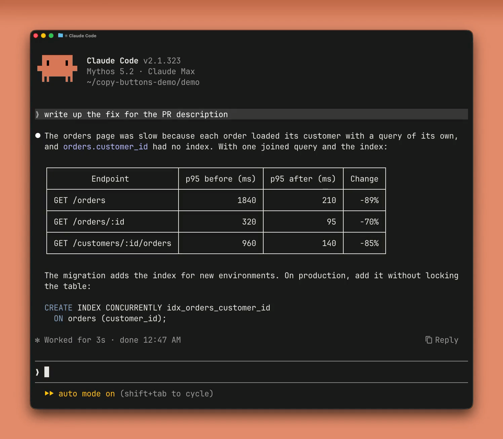

<h1>
  
  copy-buttons
</h1>

One-click copy buttons for Claude Code: on each code block and table while the pointer is over it, and at the end of every answer.



- **A table**: `markdown` copies it as Claude wrote it, `sheet` as rows to paste into Excel or Google Sheets, `boxed` with its borders as drawn.
- **A code block**: `copy` copies just its code.
- **A reply**: `Reply` copies the Markdown Claude wrote. Click again for the text as shown on screen.

## Install

```
/plugin install copy-buttons --marketplace leonasdev/copy-buttons
```

Answer `y` to add the marketplace, then pick a scope (user scope makes it work in every session).

> [!NOTE]
> Updates are not automatic for a marketplace you add yourself. Turn them on once: `/plugin`, the **Marketplaces** tab, `copy-buttons`, **Enable auto-update**. Or update by hand with `/plugin marketplace update copy-buttons`, then `/reload-plugins`.

## Settings

Set them when installing, or later in `/config`.

| Setting | Options (default first) | What it does |
| --- | --- | --- |
| Icon style | `standard`, `nerd-font` | The icon before each button: `⧉`, or the Nerd Font copy icon, which needs a Nerd Font. |
| Default Reply copy format | `markdown`, `rendered` | What the first click on `Reply` copies. The second click copies the other. |
| Code & table buttons | `hover`, `always`, `end-of-answer` | Where a code block's or table's buttons show: on it while the pointer is over it, on it all the time, or only at the end of the answer. |

## Troubleshooting

<details>
<summary>The buttons vanished or moved after a Claude Code update</summary>

A new Claude Code can change how it draws an answer. Update the plugin: `/plugin marketplace update copy-buttons`, then `/reload-plugins`. If that does not fix it, please [open an issue](https://github.com/leonasdev/copy-buttons/issues).

</details>

<details>
<summary>No buttons appear</summary>

The buttons need Claude Code's fullscreen mode: add `"tui": "fullscreen"` to `~/.claude/settings.json` and restart (without it, a tip says so once per session). In a long session they can take about a second to appear after Claude Code starts.

</details>

<details>
<summary>Some answers have no buttons</summary>

Only a turn's final answer gets buttons, not the text Claude writes between tool calls.

</details>

<details>
<summary>Nothing shows when the pointer is over a code block or table</summary>

Your terminal reports clicks but not pointer motion, so Claude Code never sees the pointer over it. Set Code & table buttons to `end-of-answer` in `/config`: each one's button then stays at the end of the answer, where a click is enough.

</details>

<details>
<summary>A code block or table has no button of its own</summary>

Its button is at the end of the answer instead when the plugin cannot follow how Claude Code draws the answer (a `mermaid` diagram, say, or a Claude Code update changing how it draws), or for a moment after the answer is first drawn. It is named by its file or language, or `table`; a table's copies its markdown first, then spreadsheet rows on a second click, and it boxed on a third. An empty code block has no button at all.

</details>

<details>
<summary>Selecting a code block with the mouse copies the button too</summary>

While a block's button is on screen (with the pointer over it, or all the time with `always`), a selection that takes in the button's row takes in its text. Start the selection from outside the block, or use the button. The same goes for a table.

</details>

<details>
<summary>It says copied, but nothing pastes</summary>

Over SSH, copying reaches your computer's clipboard through OSC 52, and some terminals drop it without telling Claude Code. Allow OSC 52 (clipboard access) in your terminal's settings; in tmux, `set -g set-clipboard on`. Some terminals also limit how much text OSC 52 may carry.

</details>

<details>
<summary>The icon shows as a box or a question mark</summary>

The `nerd-font` icon needs a [Nerd Font](https://www.nerdfonts.com) in your terminal. Install one, or set Icon style back to `standard` in `/config`.

</details>

<details>
<summary>Excel changes my numbers</summary>

Excel guesses each cell's format when pasting: `007` becomes `7`, `1/2` becomes a date. Format the target cells as text first.

</details>

## Known limitations

Tested with Claude Code 2.1.318 to 2.1.326. The plugin relies on how Claude Code draws answers and writes transcripts, and on a plugin API still in early access; a later update can break it. Please [open an issue](https://github.com/leonasdev/copy-buttons/issues) if one does.

- **An answer with a `mermaid` diagram**: its code blocks and tables have their buttons at the end of the answer, not on them.
- **A narrow window**: a block's or table's button can cover the end of its first row while the pointer is over it.
- **tmux with Devanagari (Hindi) text**: a block's buttons and flash can look a row off.
- **The Claude desktop app**: the plugin does nothing there; the app has its own copy buttons.

## Development

- How it works: [docs/how-it-works.md](docs/how-it-works.md).
- The checks, CI and releasing: [docs/development.md](docs/development.md).

## Credits

Markdown is parsed with [marked](https://github.com/markedjs/marked) v15.0.12 (MIT), bundled in `hooks/vendor/` with its license.

## License

[MIT](LICENSE)
